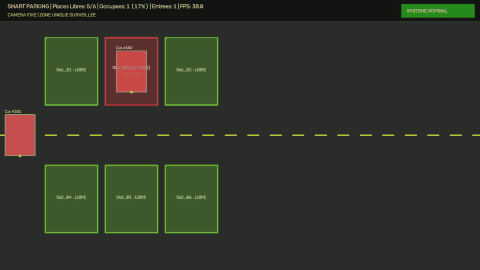
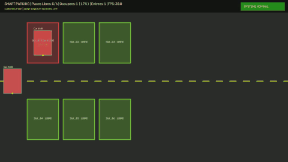
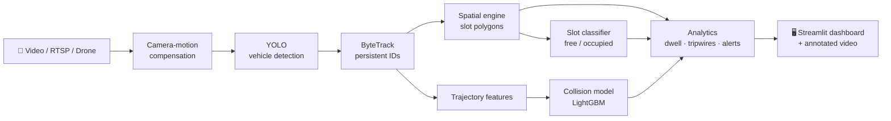

<!-- ═══════════════════════════ HEADER ═══════════════════════════ -->
<p align="center">
  
</p>

<p align="center">
  <a href="#-features">
    
  </a>
</p>

<p align="center">
  
  
  
  
  
  
  
</p>

<p align="center">
  <a href="#-demo">Demo</a> •
  <a href="#-features">Features</a> •
  <a href="#-architecture">Architecture</a> •
  <a href="#-quick-start">Quick start</a> •
  <a href="#-project-structure">Structure</a> •
  <a href="#-roadmap">Roadmap</a>
</p>

---

## 📌 About

Ground sensors for parking (magnetic or ultrasonic) are expensive, need civil works, and break down.
This project uses **the surveillance cameras a lot already has** (fixed or drone) to:

- detect and **track every vehicle** with a persistent ID,
- keep a **live map of free 🟢 / occupied 🔴 slots**,
- turn the tracks into useful signals: **dwell time, overstays, badly parked cars, near-misses and collisions**.

> Semester project — *Visual Tracking & Intelligent Applications*.
> The original Phase 1 scoping document lives in [`docs/PHASE1_CADRAGE.md`](docs/PHASE1_CADRAGE.md).

---

## 🎬 Demo

<table>
  <tr>
    <td align="center"><br/><b>1 · Proper parking & dwell time</b></td>
    <td align="center"><br/><b>2 · Line straddling (bad parking)</b></td>
  </tr>
  <tr>
    <td align="center"><br/><b>3 · Near-miss in the aisle</b></td>
    <td align="center"><br/><b>4 · Confirmed collision</b></td>
  </tr>
</table>

<details>
<summary>📸 Real footage (drone & fixed camera)</summary>
<br/>
<p align="center">
  <br/>
  
</p>
<!-- TODO: replace with a GIF of the real pipeline once detection is stable -->
</details>

---

## ✨ Features

| | Feature | Status |
|---|---|:---:|
| 🚗 | Vehicle detection (YOLO) — fixed cameras | ✅ |
| 🚁 | Top-down / drone detection (geo-trax aerial YOLOv8s, `aerial` mode) | ✅ |
| 🎯 | Multi-object tracking with persistent IDs (ByteTrack) | ✅ |
| 🅿️ | Slot occupancy map (polygon slots + CNN classifier) | ✅ |
| 🗺️ | Automatic slot map from parked cars (`tools/auto_slots_from_detections.py`) | ✅ |
| 🚪 | Virtual tripwires: entry / exit counters | ✅ |
| 📊 | Global occupancy rate | ✅ |
| ⏱️ | Dwell time per car + overstay alert | ✅ |
| ↔️ | Line-straddling / double-parking detection | ✅ |
| 💥 | Near-miss & collision prediction (LightGBM on trajectories) | ✅ |
| 🚁 | Camera-motion compensation (keyframe GMC, ~1–4 px ground error) | ✅ |
| 🖥️ | Streamlit dashboard | ✅ |

<sub>✅ working · 🚧 in progress · ⏳ planned</sub>

---

## 🧠 Architecture



| Module | Role |
|---|---|
| [`src/motion_compensator.py`](src/motion_compensator.py) | Stabilises drone / moving-camera footage |
| [`src/tracker.py`](src/tracker.py) | YOLO detection + ByteTrack tracking (`aerial=True` for drone footage) |
| [`src/aerial_detector.py`](src/aerial_detector.py) | Tiled detector for small top-down cars |
| [`src/spatial_engine.py`](src/spatial_engine.py) | Matches tracks to slot polygons, tripwires, dwell time |
| [`src/slot_classifier.py`](src/slot_classifier.py) | CNN that labels each slot crop free / occupied |
| [`src/trajectory_features.py`](src/trajectory_features.py) · [`src/collision_model.py`](src/collision_model.py) | Near-miss / collision prediction |
| [`src/visualizer.py`](src/visualizer.py) | On-frame overlays |
| [`app.py`](app.py) | Streamlit dashboard |
| [`main.py`](main.py) | CLI: run on a video or one of the 4 simulation scenarios |

---

## 🚀 Quick start

```bash
# 1. Environment
python -m venv .venv
.venv\Scripts\activate          # Windows  (Linux/macOS: source .venv/bin/activate)
pip install -r requirements.txt
python tools/download_models.py   # aerial detector for the drone video

# 2. Dashboard
streamlit run app.py

# 3. CLI — real video with a slot config
python main.py --source data/raw_videos/my_video.mp4 --config configs/drone_parking_lot.json --model yolov8n.pt

# 4. CLI — simulation scenario (1 to 4)
python main.py --scenario 3
```

<details>
<summary>🗺️ Defining parking slots for a new camera</summary>

1. Put a video in `data/raw_videos/`.
2. **Top-down / drone, mostly-full lot:** generate the map from the parked cars, then check the preview image:
   `python tools/auto_slots_from_detections.py --video data/raw_videos/my_video.mp4 --out configs/my_slots.json`
3. **Otherwise:** draw the slot polygons by hand with
   `python calibrate_slots.py --video data/raw_videos/my_video.mp4 --output configs/my_slots.json`.
4. Pass that JSON with `--config`.
</details>

<details>
<summary>📏 Evaluating occupancy accuracy</summary>

```bash
python tools/eval_occupancy.py --video <video> --config <slots.json> --labels <labels> --modes rule cnn fusion
```

⚠️ Always validate on a **different video / session / parking lot** than the one used for training — frames from the same clip are near-duplicates and give inflated scores.
</details>

---

## 🧩 Models

Weights are **not committed** (see `.gitignore`). Put them at the repo root or in `models/`:

| File | What it is | Where it comes from |
|---|---|---|
| `yolov8n.pt` / `yolov8n-seg.pt` | COCO vehicle detector (fixed, oblique cameras) | downloaded automatically by Ultralytics |
| `models/geotrax_yolov8s_1920.pt` | **aerial vehicle detector (drone footage)** — CC-BY-4.0 | `python tools/download_models.py` |
| `models/visdrone_yolov8s.pt` | aerial alternative (VisDrone) — AGPL-3.0 | `python tools/download_models.py --all` |
| `models/yolov8n_parking*.pt` | ⚠ old fine-tune, collapsed in training — do not use | `train_parking.py` |
| slot classifier `best.pt` | free / occupied CNN | `tools/finetune_slot_classifier.py` |
| `models/collision_lgbm.txt` | collision model | `tools/train_collision_model.py` (committed) |

Datasets used: **PKLot**, **CNRPark-EXT**, and our own drone / fixed-camera clips.

---

## 📁 Project structure

```text
.
├── app.py                 # Streamlit dashboard
├── main.py                # CLI entry point
├── src/                   # Core pipeline (tracking, spatial engine, classifiers…)
├── tools/                 # Dataset building, labelling, training & evaluation scripts
├── configs/               # Slot polygons / zones per camera + dataset YAMLs
├── notebooks/             # Exploration & training notebooks
├── assets/                # Images & GIFs used in docs
├── docs/                  # Project documents (Phase 1 scoping, …)
├── tests/                 # pytest suite
├── data/                  # (local) raw videos, datasets, simulations
├── datasets/              # (local) generated slot crops
├── models/                # (local) trained weights
└── runs/                  # (local) Ultralytics training runs
```

---

## 🛣️ Roadmap

- [x] Aerial detector (geo-trax) + ByteTrack for drone footage (0 → ~220 of 241 slots correctly occupied)
- [x] Auto-generated slot map for the drone lot (241 slots, replaces the misaligned hand-drawn one)
- [x] Keyframe-based GMC (old frame-to-frame GMC drifted up to 41 px)
- [x] Top-down rules for straddling / near-miss / collision (swept-box time-to-contact)
- [x] Commercial-lot slots traced from the painted bay lines (18 angled bays) + oblique-camera rules (ground-band footprint, homography-stabilised speeds)
- [x] Auto slot map skips gaps that cross grass islands (no more phantom empty slots)
- [ ] Retrain the slot classifier on PKLot + CNRPark with a **held-out parking lot** for validation
- [ ] Hand-label one frame per video to measure occupancy accuracy
- [ ] Port dwell time, tripwires and collision alerts onto the new base
- [ ] Real-footage demo GIF in this README
- [ ] Alerts export (CSV / webhook)

---

## 🧪 Tests

```bash
pytest tests/
```

---

<p align="center">
  
</p>
