<!-- ═══════════════════════════ HEADER ═══════════════════════════ -->
<p align="center">
  
</p>

<p align="center">
  <a href="#-features">
    
  </a>
</p>

<p align="center">
  
  
  
  
  
  
  
  
  
</p>

<p align="center">
  <a href="#-demo">Demo</a> •
  <a href="#-how-it-works">How it works</a> •
  <a href="#-project-structure">Structure</a> •
  <a href="#-models">Models</a> •
  <a href="#-module-reference-src">Modules</a> •
  <a href="#-tools-reference-tools">Tools</a> •
  <a href="#-algorithms-explained">Algorithms</a> •
  <a href="#-quick-start">Quick start</a> •
  <a href="#-roadmap">Roadmap</a>
</p>

<p align="center">
  
</p>

---

## 📌 About

Ground sensors for parking (magnetic or ultrasonic) are expensive, need civil works, and break down.
This project uses **the surveillance cameras a lot already has** (fixed or drone) to:

- detect and **track every vehicle** with a persistent ID,
- keep a **live map of free 🟢 / occupied 🔴 slots**,
- turn the tracks into useful signals: **dwell time, overstays, badly parked cars, near-misses and collisions**.

> Semester project — *Visual Tracking & Intelligent Applications*.
> The original Phase 1 scoping document lives in [`docs/PHASE1_CADRAGE.md`](docs/PHASE1_CADRAGE.md).

<details>
<summary><b>🧭 New here? Pick a path</b> (click to expand)</summary>
<br/>

| I want to… | Go to |
|---|---|
| See it running in 2 minutes | [🚀 Quick start](#-quick-start) → `streamlit run app.py` |
| Understand the pipeline end to end | [🔄 How it works](#-how-it-works) |
| Know which file does what | [📁 Project structure](#-project-structure) |
| Know which neural nets are used and why | [🧩 Models](#-models) |
| Read the API of a class / function | [🔬 Module reference](#-module-reference-src) |
| Set it up on **my own camera** | [🗺️ Defining parking slots](#-quick-start) → [🔧 Tools](#-tools-reference-tools) |
| Understand the math (hysteresis, TTC, GMC) | [📐 Algorithms explained](#-algorithms-explained) |

</details>

---

## 🎬 Demo

<table>
  <tr>
    <td align="center"><br/><b>1 · Proper parking & dwell time</b></td>
    <td align="center">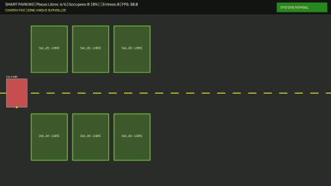<br/><b>2 · Line straddling (bad parking)</b></td>
  </tr>
  <tr>
    <td align="center"><br/><b>3 · Near-miss in the aisle</b></td>
    <td align="center"><br/><b>4 · Confirmed collision</b></td>
  </tr>
</table>

<details>
<summary>📸 Real footage (drone & fixed camera)</summary>
<br/>
<p align="center">
  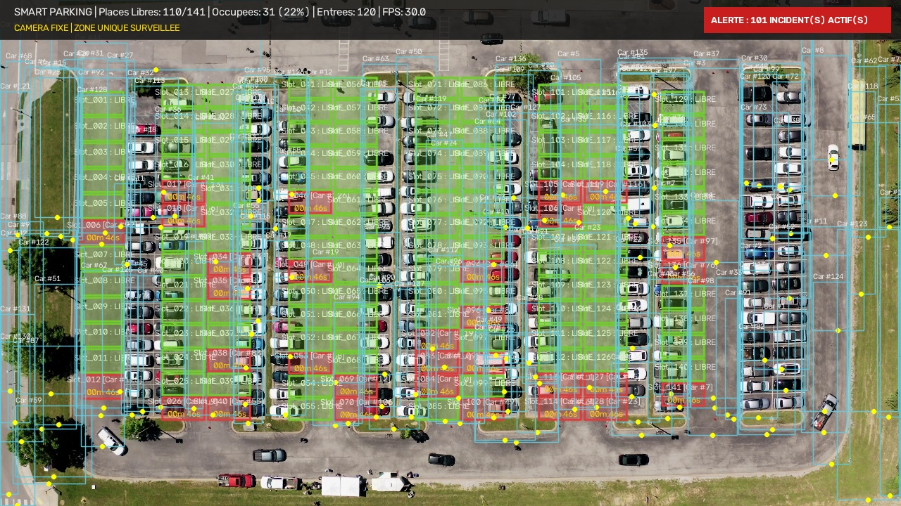<br/>
  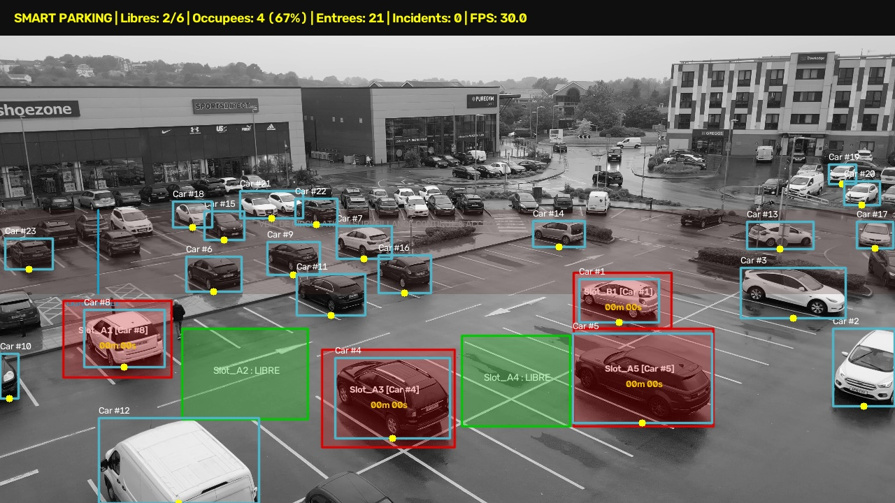
</p>
<!-- TODO: replace with a GIF of the real pipeline once detection is stable -->
</details>

<details>
<summary>🗺️ Auto-generated slot maps (preview images)</summary>
<br/>
<p align="center">
  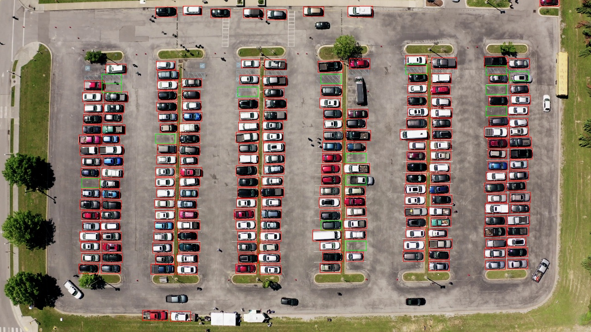<br/><sub>Drone lot — slots built from persistent parked-car detections</sub><br/><br/>
  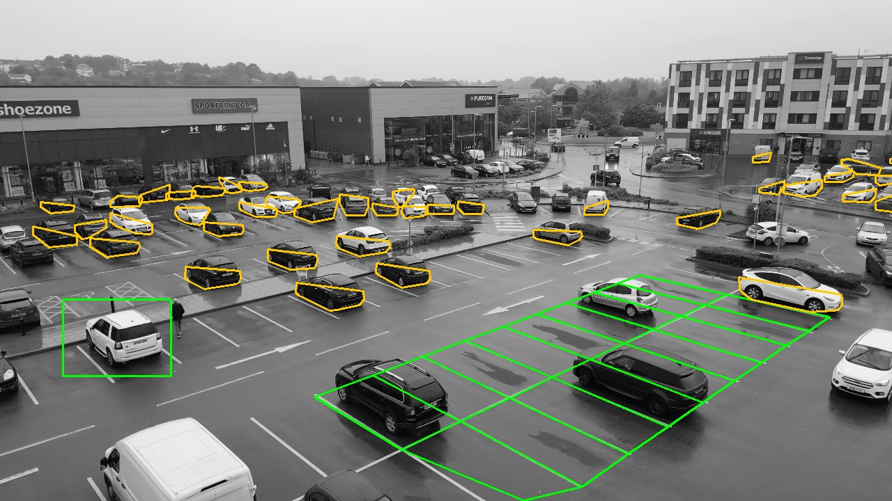<br/><sub>Commercial lot (oblique camera) — traced bays + one ground-band slot per parked car</sub>
</p>
</details>

---

## ✨ Features

| | Feature | Status |
|---|---|:---:|
| 🚗 | Vehicle detection (YOLO) — fixed cameras | ✅ |
| 🚁 | Top-down / drone detection (geo-trax aerial YOLOv8s, `aerial` mode) | ✅ |
| 🎯 | Multi-object tracking with persistent IDs (ByteTrack) | ✅ |
| 🅿️ | Slot occupancy map (polygon slots + CNN classifier) | ✅ |
| 🗺️ | Automatic slot map from parked cars (`tools/auto_slots_from_detections.py`) | ✅ |
| 🚪 | Virtual tripwires: entry / exit counters | ✅ |
| 📊 | Global occupancy rate | ✅ |
| ⏱️ | Dwell time per car + overstay alert | ✅ |
| ↔️ | Line-straddling / double-parking detection | ✅ |
| 💥 | Near-miss & collision prediction (LightGBM on trajectories) | ✅ |
| 🚁 | Camera-motion compensation (keyframe GMC, ~1–4 px ground error) | ✅ |
| 🖥️ | Streamlit dashboard | ✅ |

<sub>✅ working · 🚧 in progress · ⏳ planned</sub>

---

## 🔄 How it works

<p align="center">
  
</p>

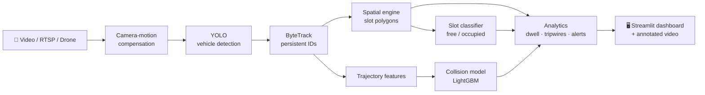

<details>
<summary><b>🔁 What happens to a single frame</b> — sequence diagram</summary>
<br/>

This is the loop in [`main.py`](main.py) → `run_video_pipeline()` (the dashboard runs the same steps).

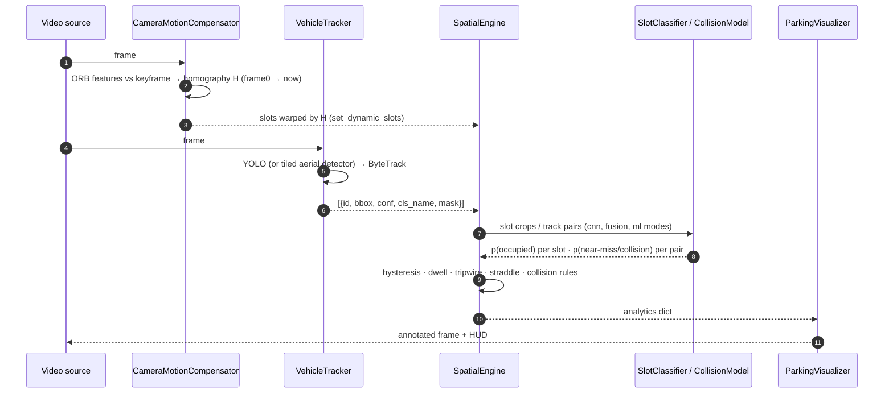

</details>

<details>
<summary><b>🧱 Class diagram of the core package</b></summary>
<br/>

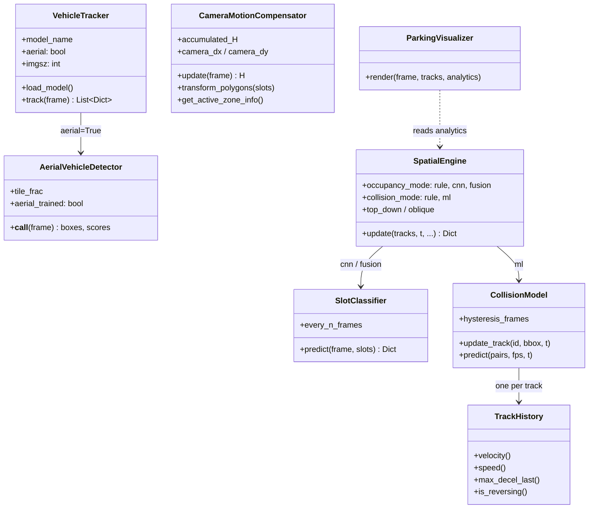

</details>

---

## 📁 Project structure

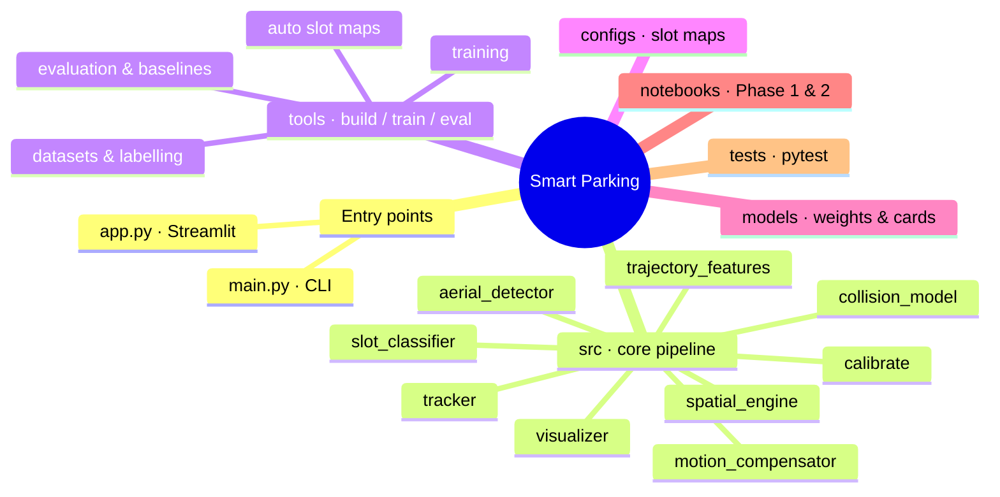

<details open>
<summary><b>🌳 Annotated tree</b></summary>
<br/>

```text
.
├── app.py                        # 🖥️ Streamlit dashboard ("Parking Watch"): episodes, upload, webcam, model settings
├── main.py                       # ⌨️ CLI: real video / webcam, or one of the 4 simulation scenarios
├── requirements.txt
│
├── src/                          # 🧠 Core pipeline — imported by app.py and main.py
│   ├── tracker.py                #   YOLO detection + ByteTrack → tracks with persistent IDs (+ seg masks)
│   ├── aerial_detector.py        #   Detector for top-down drone footage (tiled COCO fallback / aerial weights)
│   ├── motion_compensator.py     #   Keyframe GMC: ORB + RANSAC homography, warps slots with the camera
│   ├── spatial_engine.py         #   Slots ↔ tracks: occupancy, hysteresis, dwell, tripwire, straddle, collisions
│   ├── slot_classifier.py        #   CNN free/occupied classifier on rectified slot crops
│   ├── trajectory_features.py    #   Metric pair features (TTC, closing speed, decel, reversing…)
│   ├── collision_model.py        #   Runtime LightGBM near-miss / collision predictor with hysteresis
│   ├── visualizer.py             #   Overlays: slots, boxes, IDs, HUD, alert pulses
│   ├── calibrate.py              #   Click-4-corners slot calibration (+ px/metre scale)
│   ├── pipeline.py               #   One frame end to end; GMC runs in parallel with GPU detection
│   ├── video_io.py               #   Background frame reader (decode + 4K→720p off the main thread)
│   ├── model_cache.py            #   Load YOLO weights once per process + background GPU warm-up
│   └── replay_cache.py           #   Analyse a clip once, replay it at native fps afterwards
│
├── tools/                        # 🛠️ One-off scripts: build slot maps, datasets, train, evaluate
│   ├── auto_slots_from_detections.py   # Drone: slot map from persistent parked cars
│   ├── auto_slots_oblique.py           # Pole camera: one ground-band slot per parked car
│   ├── label_slots_interactive.py      # Click slots to label ground truth → labels.csv
│   ├── build_slot_dataset.py           # PKLot / folders / video → yolo-classify dataset
│   ├── finetune_slot_classifier.py     # Adapt the slot CNN to a new camera
│   ├── simulate_trajectories.py        # Synthetic metric car-park conflicts (shapely labels)
│   ├── train_collision_model.py        # LightGBM 3-class training + report
│   ├── eval_occupancy.py               # rule vs cnn vs fusion against hand labels
│   ├── baseline_ultralytics_parking.py # Ultralytics ParkingManagement baseline for comparison
│   └── download_models.py              # Fetch aerial detectors from Hugging Face
│
├── configs/                      # 🗺️ Slot polygons per camera (+ lane / no-slot zones) and dataset YAMLs
├── models/                       # ⚖️ Weights (git-ignored except LightGBM) + model_cards/
├── notebooks/                    # 📓 Phase 1 simulation, Phase 2 GMC, Phase 2 fine-tuning
├── reports/                      # 📈 collision_eval.md and training logs
├── assets/                       # 🖼️ GIFs, SVGs and images used in docs
├── docs/                         # 📄 Phase 1 scoping
├── tests/                        # 🧪 pytest (trajectory features / TTC)
├── data/ · datasets/ · runs/     # (local) raw videos, slot crops, Ultralytics runs
└── *.py at root                  # 🧪 Phase 1 experiments — see "Legacy scripts" below
```

</details>

<details>
<summary><b>🗂️ Config file schema</b> (<code>configs/*.json</code>)</summary>
<br/>

Two shapes are accepted by `SpatialEngine._load_config()`:

```jsonc
// 1. Legacy: a flat list of slots
[
  { "id": 1, "name": "A1", "polygon": [[x,y],[x,y],[x,y],[x,y]], "max_dwell_minutes": 120 }
]

// 2. Full: slots + zones + optional scale
{
  "px_per_metre": 42.0,                     // from src/calibrate.py --ref-metres (fallback 75)
  "slots":         [ { "id", "name", "zone", "polygon", "max_dwell_minutes" } ],
  "lane_zones":    [ { "polygon": [...] } ], // aisles: obstruction + collision checks
  "no_slot_zones": [ { "polygon": [...] } ]  // roads, kiosks — ignored by auto_slots_oblique.py
}
```

| File | Camera | Slots |
|---|---|---|
| `drone_parking_lot_auto.json` | Drone, top-down (4K) | 235 auto-generated |
| `drone_parking_lot.json` | Drone | hand-drawn (superseded, misaligned) |
| `commercial_parking_zones.json` | Oblique pole camera | 73 (traced bays + parked-car slots), 1 lane, 2 no-slot zones |
| `commercial_parking_slots.json` | Oblique pole camera | earlier traced version |
| `parking_slots.json` | Simulation scenarios | 6 |

Every auto-generated map writes a `*.preview.jpg` next to it — **always look at it** before using the config.

</details>

---

## 🧩 Models

Weights are **not committed** (see `.gitignore`), except the small LightGBM model. Put them at the repo root or in `models/`.

| | Model | Task | Architecture | Trained on | Used by |
|---|---|---|---|---|---|
| 🚗 | `yolov8n.pt` · `yolov8n-seg.pt` · `yolov8s-seg.pt` · `yolov8m-seg.pt` | Vehicle detection (+ masks) on fixed / oblique cameras | YOLOv8 detect / segment | COCO (car, motorcycle, bus, truck) | `VehicleTracker` |
| 🚁 | `models/geotrax_yolov8s_1920.pt` | **Aerial vehicle detection** (default for drone) | YOLOv8s, 1920 px | geo-trax drone dataset — CC-BY-4.0 | `AerialVehicleDetector` |
| 🚁 | `models/visdrone_yolov8s.pt` | Aerial alternative | YOLOv8s | VisDrone — AGPL-3.0 | `AerialVehicleDetector` |
| 🅿️ | `runs/classify/train/weights/best.pt` | Slot **free / occupied** | YOLO11n-cls (from `yolo11n-cls.pt`) | PKLot (+ your camera via fine-tune) | `SlotClassifier` |
| 💥 | `models/collision_lgbm.txt` (+ `.json` meta) | NORMAL / NEAR_MISS / COLLISION per car pair | LightGBM, 3 classes, 13 features | Synthetic trajectories (`simulate_trajectories.py`) | `CollisionModel` |
| ⚠️ | `models/yolov8n_parking*.pt` | old parking fine-tune | YOLOv8n | — | **collapsed in training (conf 1.00 on trees/grass) — do not use** |

<details>
<summary><b>🚗 YOLOv8 (COCO) — fixed & oblique cameras</b></summary>
<br/>

- Loaded lazily in `VehicleTracker.load_model()`. Vehicle classes are **resolved by name** from `model.names` (`car`, `motorcycle`, `bus`, `truck`, `van`, `vehicle`…), so a custom checkpoint with different class ids still works. Slot-state labels like `occupied_slot` are deliberately **not** tracked — they produced giant per-row boxes that looked like straddle parking.
- **Segmentation checkpoints** (`*-seg.pt`) also return each car's mask polygon. `SpatialEngine` then measures true footprint overlap with a slot instead of the bbox, which matters on oblique views where the box contains a lot of background.
- `imgsz` defaults to 640; the commercial lot uses **1280** so the 30–40 px cars in the far rows remain detectable.

</details>

<details>
<summary><b>🚁 Aerial detector — drone / top-down footage</b></summary>
<br/>

Stock COCO YOLO misses top-down cars (they're small and it often calls them *cell phones*). `AerialVehicleDetector` has two regimes:

| Regime | When | How |
|---|---|---|
| **Aerial-trained** (geo-trax / VisDrone) | the weights already know `car` | full frame, `imgsz ≥ 1280`, `conf ≥ 0.25` |
| **COCO fallback** | only COCO weights available | overlapping tiles (⅓ of frame width, 20 % overlap) at 1024 px, `conf 0.05`, class-agnostic over top-down look-alikes, merged with `torchvision.ops.nms` |

Both regimes end in a **size filter**: boxes whose long side is outside ~1.6–8.5 % of frame width (pedestrians, merged rows, trees) are dropped.
In aerial mode the tracker uses a standalone `BYTETracker` with `track_buffer ≥ 2 s`, `fuse_score=False`, and lowered thresholds for the COCO fallback so low-score parked cars still get IDs.

Get the weights: `python tools/download_models.py` (add `--all` for VisDrone). Model cards in [`models/model_cards/`](models/model_cards/).

</details>

<details>
<summary><b>🅿️ Slot classifier — CNN on rectified crops</b></summary>
<br/>

1. Each visible slot polygon (4 corners) is **perspective-warped** into a fixed-size upright crop (`_rectify`).
2. All crops go through **one batched** `yolo classify` call at 224 px.
3. Results are **cached for `every_n_frames` (default 3)** so the dashboard stays real-time with hundreds of slots.
4. Output: `{slot_id: p(occupied)}` → used by `SpatialEngine` in `cnn` or `fusion` mode.

Training path: PKLot → `build_slot_dataset.py` → `yolo classify train` (**99.1 % top-1 on a held-out lot**), then `finetune_slot_classifier.py` adapts it to your camera (15 epochs, `lr0 = 0.0005`; from scratch it's `yolo11n-cls.pt`, 60 epochs, `lr0 = 0.01`).

</details>

<details>
<summary><b>💥 LightGBM collision model</b></summary>
<br/>

- **Input**: 13 features per pair of tracks, computed in metres by `trajectory_features.pair_features()`:
  `d, v_close, ttc, ttc_min_1s, heading_rel, speed_a, speed_b, decel_a, decel_b, reversing_a, reversing_b, in_aisle_a, in_aisle_b`.
- **Labels**: generated by exact geometry (shapely polygon contact / clearance) on noise-free simulated trajectories — never by a hand-tuned rule.
- **Runtime**: `CollisionModel` only scores pairs closer than **8 m**, alerts at `p(COLLISION) ≥ 0.6` or `p(NEAR_MISS ∨ COLLISION) ≥ 0.5`, and requires **3 consecutive frames** before flipping state.
- **Evaluation** on a held-out parameter range (car B faster than 5 m/s) — from [`reports/collision_eval.md`](reports/collision_eval.md):

| Method | COLLISION recall | NEAR_MISS recall | Mean lead time |
|---|:---:|:---:|:---:|
| LightGBM | **0.79** | **0.35** | **0.80 s** before the event |
| Pixel rule (ported to metres) | 0.01 | 0.10 | — |

> ⚠️ Real footage is converted to metres with a single px/m scale until a proper ground homography (add-on A) exists.

</details>

Datasets used: **PKLot**, **CNRPark-EXT**, synthetic trajectories, and our own drone / fixed-camera clips.

---

## 🔬 Module reference (`src/`)

<details>
<summary><b><code>tracker.py</code> — <code>VehicleTracker</code></b> · detection + tracking</summary>
<br/>

| Member | What it does |
|---|---|
| `__init__(model_name="yolov8n.pt", tracker_type="bytetrack.yaml", conf_threshold=0.35, iou_threshold=0.5, aerial=False, fps=30, imgsz=640)` | Configure the detector; `aerial=True` switches to the tiled/aerial path |
| `load_model()` | Lazy-load YOLO and resolve which class ids are vehicles |
| `track(frame) → List[Dict]` | Run detection + ByteTrack. Each track: `{"id", "bbox": (x1,y1,x2,y2), "conf", "cls_name", "mask"}` |
| `_track_aerial(frame)` | Aerial path: `AerialVehicleDetector` → standalone `BYTETracker` |

</details>

<details>
<summary><b><code>aerial_detector.py</code> — <code>AerialVehicleDetector</code></b> · small top-down cars</summary>
<br/>

| Member | What it does |
|---|---|
| `__init__(model_path, tile_frac=1/3, overlap=0.2, imgsz=1024, conf=0.05, nms_iou=0.4, min_side_frac, max_side_frac, class_agnostic=None)` | Auto-detects whether the weights are aerial-trained (no `cell phone` class) |
| `__call__(frame) → (boxes[N,4], scores[N])` | Full-frame or tiled inference, NMS-merged across tiles |
| `_tiles(H, W)` | Overlapping square tile grid covering the frame edge to edge |
| `_size_filter(boxes, scores, W)` | Drop boxes too small / too large to be a car |

</details>

<details>
<summary><b><code>motion_compensator.py</code> — <code>CameraMotionCompensator</code></b> · moving / drifting cameras</summary>
<br/>

| Member | What it does |
|---|---|
| `__init__(max_features=500, proc_width=640)` | ORB on a 640 px copy (1280 px cost ~45 ms/frame) |
| `update(frame) → H` | Homography **frame 0 → current frame**, matched against a keyframe (see [GMC](#-algorithms-explained)) |
| `_match_homography(...)` | Brute-force Hamming matching, top-200, RANSAC 3 px, needs ≥ 25 inliers |
| `transform_polygons(slots, frame_width, frame_height)` | Warp slot polygons with `H`; flag slots that left the view (`is_visible`) |
| `get_active_zone_info()` | Active zone (entrance / aisle / east wing…) and camera pan offset for the HUD |
| `camera_dx`, `camera_dy` | Per-frame camera shift, used to compute true ground velocity |

</details>

<details>
<summary><b><code>spatial_engine.py</code> — <code>SpatialEngine</code></b> · the analytics brain</summary>
<br/>

Constructor highlights: `hysteresis_window=30`, `occupied_threshold=0.8`, `free_threshold=0.2`, `obstruction_threshold_sec=2.5`, `collision_dist_threshold=75 px`, `near_miss_dist_threshold=120 px`, `occupancy_mode ∈ {rule, cnn, fusion}`, `collision_mode ∈ {rule, ml}`, `top_down`, `oblique`, `px_per_metre`.

| Member | What it does |
|---|---|
| `update(tracked_vehicles, current_time, camera_dx, camera_dy, frame, ground_H) → Dict` | One frame of analytics: slot assignment, occupancy, dwell, tripwire, straddle, obstruction, collisions |
| `set_dynamic_slots(slots)` / `set_dynamic_lane_zones(zones)` | Receive GMC-warped geometry each frame |
| `get_bottom_contact_point(bbox)` | Bottom-centre of a box ≈ where the car touches the ground |
| `get_footprint_samples(bbox)` / `get_topdown_samples(bbox)` | Sample points for oblique (lower ⅔ + bottom edge) vs top-down (whole box) footprints |
| `slot_footprint_overlap(bbox, polygon)` | Share of a car's footprint inside a slot |
| `slot_mask_overlap(mask, polygon, ...)` | Same, using the segmentation mask when available |
| `time_to_overlap(b1, v1, b2, v2, horizon, margin)` | **Swept-box** time until two moving boxes touch (top-down collision rule) |
| `compute_bbox_overlap(boxA, boxB)` | IoU-style overlap of two boxes |
| `is_point_in_slot(point, polygon)` | Point-in-polygon test |

Camera modes: **`top_down`** uses the whole bbox as the footprint and rescales pixel thresholds by observed car length (reference 120 px). **`oblique`** uses the ground band of each car, because roofs project onto the bay behind and boxes overlap through occlusion.

</details>

<details>
<summary><b><code>slot_classifier.py</code> — <code>SlotClassifier</code></b></summary>
<br/>

| Member | What it does |
|---|---|
| `__init__(weights_path, device="cpu", every_n_frames=3, imgsz=224)` | Load a 2-class `yolo classify` model and find the `occupied` index |
| `predict(frame, slots) → {slot_id: p_occupied}` | Batched inference on rectified crops, cached between real passes |
| `_rectify(frame, polygon)` | 4-point perspective warp to a fixed crop |

</details>

<details>
<summary><b><code>trajectory_features.py</code></b> — pure-numpy pair features (unit-tested)</summary>
<br/>

| Member | What it does |
|---|---|
| `TrackSample(t, x, y, heading)` | One timestamped position in metres |
| `TrackHistory.push(sample, window_s=1.0)` | Rolling 1 s history |
| `.velocity()` · `.speed()` | Finite-difference velocity (m/s) |
| `.max_decel_last(window_s=0.5)` | Hardest braking in the last 0.5 s |
| `.is_reversing()` | Moving against its heading |
| `time_to_collision(p_rel, v_rel, r)` | Closed-form TTC for two discs (quadratic root), capped when no contact |
| `pair_features(hist_a, hist_b, fps, aisle_polygon)` | The 13-feature dict listed in [Models](#-models) |
| `FEATURE_NAMES` | Canonical feature order shared by training and runtime |

</details>

<details>
<summary><b><code>collision_model.py</code> — <code>CollisionModel</code></b></summary>
<br/>

| Member | What it does |
|---|---|
| `__init__(model_path, pixel_to_metre_scale, hysteresis_frames=3)` | Load the LightGBM booster + thresholds from the sibling `.json` |
| `update_track(track_id, bbox, t)` | Push a track's bottom-centre (converted to metres) and heading |
| `predict(pairs, fps, t) → List[Dict]` | Class probabilities and debounced alert state for each close pair |

</details>

<details>
<summary><b>⚡ Performance & loading — <code>pipeline.py</code> · <code>video_io.py</code> · <code>model_cache.py</code> · <code>replay_cache.py</code></b></summary>
<br/>

| Member | What it does |
|---|---|
| `FramePipeline(engine, tracker, visualizer).process(frame, t)` | GMC → slot warp → track → engine → render for one frame. GMC (CPU) runs on a worker thread while the tracker waits on the GPU |
| `FrameReader(path)` · `.read() → (ok, frame, pos_ms)` | Decodes and resizes upcoming frames on a background thread (4K decode + resize ≈ 50–60 ms, now hidden) |
| `get_yolo(path, role)` | Process-wide model cache (`track` / `detect` / `classify`); resets tracker state so every run starts at ID 1 |
| `start_warmup(specs)` · `wait_warmup()` | Loads the default detectors + one dummy inference when the dashboard opens (cold start ≈ 15–20 s) |
| `make_key(...)` · `ReplayWriter` · `load(key)` | Records annotated frames + dashboard numbers during the first analysis; later plays stream them at the clip's frame rate. The key covers video, config, weights, settings and `src/` code. Stored in `data/cache/replays/` (12 most recent kept) |
| `ui_record(analytics)` | Compact, JSON-safe per-frame numbers shown by the dashboard |

Thumbnails are written once to `static/thumbs/` and served by Streamlit's static file server (`server.enableStaticServing`).

</details>

<details>
<summary><b><code>visualizer.py</code> — <code>ParkingVisualizer</code></b> · <b><code>calibrate.py</code> — <code>ParkingCalibrator</code></b></summary>
<br/>

| Member | What it does |
|---|---|
| `ParkingVisualizer.render(frame, tracks, analytics, ...)` | Draws visible slots (green/red), minimalist boxes + IDs, ground contact dots, HUD (zone, pan, occupancy) and pulsing collision / near-miss rings |
| `ParkingVisualizer.set_dynamic_slots(slots)` | Use the GMC-warped slots for this frame |
| `ParkingCalibrator.run()` | OpenCV window: click 4 corners per slot, HUD shows progress |
| `ParkingCalibrator.mouse_callback(...)` · `draw_hud(img)` · `save_to_json()` | Interaction, overlay and export to `configs/*.json` |

</details>

<details>
<summary><b>Entry points — <code>main.py</code> & <code>app.py</code></b></summary>
<br/>

**`main.py`** (CLI)

| Function | What it does |
|---|---|
| `run_video_pipeline(source, engine, tracker, visualizer)` | Real video / webcam: GMC → tracker → engine → visualizer, shown in an OpenCV window |
| `run_scenario_1_proper_parking(...)` | Simulated car parks correctly; dwell timer starts |
| `run_scenario_2_line_straddling(...)` | Car parks across two bays → straddle alert |
| `run_scenario_3_near_miss(...)` | Two cars close fast, one brakes → near-miss |
| `run_scenario_4_actual_collision(...)` | Impact in the aisle → confirmed collision |

Flags: `--source` (file or webcam index), `--config`, `--model`, `--scenario 1-4`.

**`app.py`** (Streamlit, "Parking Watch")

| Function | What it does |
|---|---|
| `run_dashboard()` | Main processing loop + live metrics |
| `render_browse(ep)` · `render_card(ep)` · `render_player(ep)` | Episode gallery, cards and the player view |
| `render_upload_controls()` · `render_webcam_controls()` | Upload a clip or use a webcam, choose its slot config |
| `episode_frame()` · `episode_image()` · `draw_sim_background()` | Thumbnails and simulated backgrounds |
| `select_episode()` · `start_playing()` · `stop_playing()` | Session-state callbacks |

The ⚙ **Model settings** popover lets you pick the weights file, the YOLO confidence, **Occupation: Règles / CNN / Fusion** and **Collisions: Règles / ML** (the ML options unlock once their weights exist).

</details>

---

## 🔧 Tools reference (`tools/`)

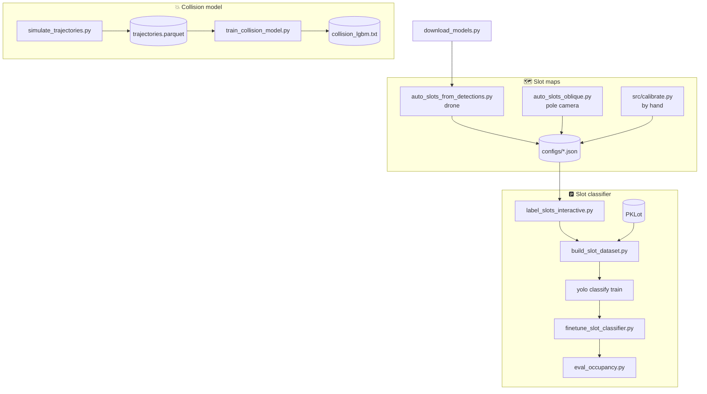

<details>
<summary><b>🗺️ Slot-map builders</b></summary>
<br/>

| Script | How it works | Key functions |
|---|---|---|
| `auto_slots_from_detections.py` | Detects cars on N sampled frames, maps them back to frame 0 with GMC, keeps boxes present on most frames (= parked), groups them into columns, and fills gaps that fit whole slots at the column's pitch. Skips gaps that cross **vegetation** (grass islands). | `to_frame0`, `iou_matrix`, `persistent_boxes`, `group_columns`, `drop_outliers`, `vegetation_mask`, `gap_crosses_vegetation`, `fill_column` |
| `auto_slots_oblique.py` | For oblique cameras: a car whose ground point stays still (in the stabilised frame) long enough is parked; its slot is the **ground band** of its segmentation mask. Slots overlapping traced bays or `no_slot_zones` are skipped. | `ground_band_polygon`, `to_frame0`, `poly_overlap`, `still_flags`, `longest_run` |

</details>

<details>
<summary><b>🅿️ Datasets, labelling & slot-classifier training</b></summary>
<br/>

| Script | Purpose | Key functions |
|---|---|---|
| `label_slots_interactive.py` | Click each slot on sampled frames to cycle *empty → occupied → skip*; writes `labels.csv` | `InteractiveLabeler.run`, `point_in_poly` |
| `build_slot_dataset.py` | Builds `train/val/test × occupied/empty` crops from **PKLot XML**, pre-cropped folders, or **your video + labels**; splits by lot/session so validation is honest | `build_from_pklot_xml`, `build_from_cropped_folders`, `build_from_video`, `warp_quad`, `assign_split` |
| `finetune_slot_classifier.py` | Continue training from the PKLot checkpoint at low LR (or from `yolo11n-cls.pt`) | `ensure_val_split`, `main` |
| `eval_occupancy.py` | Scores **rule / cnn / fusion** against `frame,slot_id,occupied` ground truth, feeding every frame so hysteresis is realistic | `load_labels`, `run_mode` |

</details>

<details>
<summary><b>💥 Collision simulation & training</b></summary>
<br/>

| Script | Purpose | Key functions |
|---|---|---|
| `simulate_trajectories.py` | Metric 2D lot (6 m aisle, 2.5 × 5 m bays, 1.8 × 4.5 m cars). Car A reverses out, car B drives the aisle; either may brake. Labels from exact shapely geometry. Supports a held-out parameter range. | `car_polygon`, `ttc_discs`, `simulate_one`, `parse_holdout` |
| `train_collision_model.py` | Per-frame feature table → 3-class LightGBM → report vs the ported pixel rule | `build_feature_table`, `rule_baseline_predict`, `mean_lead_time` |

</details>

<details>
<summary><b>📦 Utilities & baselines</b></summary>
<br/>

| Script | Purpose |
|---|---|
| `download_models.py` | Downloads geo-trax (default) / VisDrone YOLOv8s weights from Hugging Face into `models/` |
| `baseline_ultralytics_parking.py` | Runs Ultralytics' built-in `ParkingManagement` on our slot polygons for comparison (fixed-camera only — it drifts on moving footage) |

</details>

<details>
<summary><b>🧪 Legacy scripts at the repo root</b> (Phase 1 experiments)</summary>
<br/>

Kept for reference; the maintained path is `src/` + `tools/`.

| Script | What it was for |
|---|---|
| `calibrate_slots.py` | v2 interactive slot calibration (CLI used in Quick start) |
| `train_parking.py` · `finetune_model.py` · `finetune_model_old.py` | YOLOv8n parking fine-tuning (frozen backbone, cosine LR) — produced the collapsed `yolov8n_parking*.pt` |
| `download_dataset.py` · `extract_frames.py` · `semi_auto_annotate.py` · `data_augmentation.py` | Dataset download, frame extraction, YOLO-assisted annotation, augmentation |
| `debug_dataset.py` · `fix_dataset_config.py` | Diagnose / fix the YOLO dataset and its YAML |
| `evaluate_model.py` · `compare_models_v2.py` · `benchmark_adaptation.py` · `model_switcher.py` | Baseline vs fine-tuned comparisons on the 45° and 90° videos |
| `test_v2_model.py` · `test_with_finetuned_model.py` | Run a fine-tuned model on real video |
| `demo_collisions.py` · `demo_collisions_v2.py` | Standalone near-miss vs collision demos |

</details>

---

## 📐 Algorithms explained

<details>
<summary><b>🟢🔴 Slot occupancy with hysteresis</b></summary>
<br/>

A single noisy detection must not flip a slot. Each slot keeps the last **30 frames** of "car present?" votes:

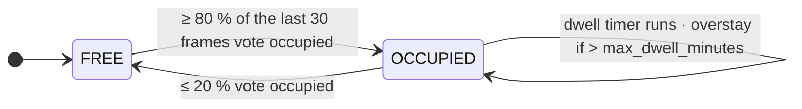

The per-frame vote depends on `occupancy_mode`:
- **`rule`** — a meaningful share of the car's footprint (bbox samples or seg mask) lies inside the polygon;
- **`cnn`** — `SlotClassifier` probability;
- **`fusion`** — both signals combined.

</details>

<details>
<summary><b>↔️ Line straddling</b></summary>
<br/>

A car is straddling when it has **genuine presence in two or more slots** at the same time *and* it is stopped (below 0.3 car lengths / s) — not just one dominant slot plus a sample point touching a line. Oblique cameras sample the ground band; top-down cameras use the whole box, otherwise every tightly parked car would be flagged.

</details>

<details open>
<summary><b>💥 Near-miss & collision</b></summary>
<br/>

<p align="center"></p>

**Rule mode** (pixels):
- distance between two cars closes by **≥ 20 px within 0.3 s** (windowed, immune to ±2 px YOLO jitter),
- relative speed **≥ 25 px/s**,
- distance under **75 px → collision**, under **120 px → near-miss**,
- parked side-by-side cars are excluded (zero false alarms on static pairs),
- top-down: **swept-box time-to-contact** (`time_to_overlap`) — extend each box along its velocity and solve for the first touch.

**ML mode** (metres): the 13 pair features → LightGBM → 3-frame hysteresis. Time-to-collision models each car as a disc of radius *r* and solves

$$\lVert p_{rel} + v_{rel}\,t \rVert = 2r \;\Rightarrow\; t = \frac{-b - \sqrt{b^2 - 4ac}}{2a},\quad a = v_{rel}\!\cdot\! v_{rel},\; b = 2\,p_{rel}\!\cdot\! v_{rel},\; c = \lVert p_{rel}\rVert^2 - (2r)^2$$

</details>

<details>
<summary><b>🧭 Keyframe global motion compensation (GMC)</b></summary>
<br/>

Drones hover and drift; pole cameras sway. Slot polygons are drawn on frame 0, so they must follow the ground.

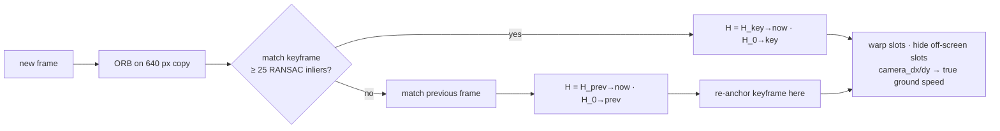

**Why a keyframe, not frame-to-frame?** Chaining per-frame homographies loses slow drift: a drone drifting ~0.1 px/frame gave ≈ identity at every step and an accumulated motion of 0 px, while the ground had actually moved 15–25 px (the old GMC drifted up to **41 px**). Matching against a fixed keyframe keeps the ground error at **~1–4 px**.

</details>

<details>
<summary><b>🚪 Tripwire, dwell time & lane obstruction</b></summary>
<br/>

- **Tripwire** — a virtual vertical line; each track ID crossing it is counted once (`crossed_ids`) → entries.
- **Dwell time** — starts when a slot turns OCCUPIED with a given car ID, compared against the slot's `max_dwell_minutes` for overstay alerts.
- **Lane obstruction** — a car stopped inside a `lane_zone` for more than **2.5 s** raises an obstruction alert.

</details>

---

## 🚀 Quick start

```bash
# 1. Environment
python -m venv .venv
.venv\Scripts\activate          # Windows  (Linux/macOS: source .venv/bin/activate)
pip install -r requirements.txt
pip install lightgbm             # only for the ML collision mode
python tools/download_models.py   # aerial detector for the drone video

# 2. Dashboard
streamlit run app.py

# 3. CLI — real video with a slot config
python main.py --source data/raw_videos/my_video.mp4 --config configs/drone_parking_lot.json --model yolov8n.pt

# 4. CLI — simulation scenario (1 to 4)
python main.py --scenario 3
```

<details>
<summary>🗺️ Defining parking slots for a new camera</summary>

1. Put a video in `data/raw_videos/`.
2. **Top-down / drone, mostly-full lot:** generate the map from the parked cars, then check the preview image:
   `python tools/auto_slots_from_detections.py --video data/raw_videos/my_video.mp4 --out configs/my_slots.json`
3. **Oblique / pole camera:** add one slot per parked car on top of any hand-traced bays (cars must stay still ≥ 0.5 s; mark roads or kiosks to ignore as `no_slot_zones` in the JSON):
   `python tools/auto_slots_oblique.py --video data/raw_videos/my_video.mp4 --base configs/my_slots.json --out configs/my_slots.json`
4. **Otherwise:** draw the slot polygons by hand with
   `python calibrate_slots.py --video data/raw_videos/my_video.mp4 --output configs/my_slots.json`.
5. Pass that JSON with `--config`.
</details>

<details>
<summary>🎓 Training the slot classifier on your camera</summary>

```bash
python src/calibrate.py --source <video_or_rtsp_url> --output configs/my_cam.json
python tools/label_slots_interactive.py --source <video_or_rtsp_url> --config configs/my_cam.json --out my_cam_labels.csv --every-sec 5
python tools/build_slot_dataset.py --source video --video <video_or_rtsp_url> --config configs/my_cam.json \
       --labels my_cam_labels.csv --group my_cam --out datasets/slots_mycam
python tools/finetune_slot_classifier.py --data datasets/slots_mycam --base runs/classify/train/weights/best.pt
```
</details>

<details>
<summary>💥 Retraining the collision model</summary>

```bash
python tools/simulate_trajectories.py      # → data/sim/trajectories.parquet
python tools/train_collision_model.py      # → models/collision_lgbm.txt + reports/collision_eval.md
```
</details>

<details>
<summary>📏 Evaluating occupancy accuracy</summary>

```bash
python tools/eval_occupancy.py --video <video> --config <slots.json> --labels <labels> --modes rule cnn fusion
```

⚠️ Always validate on a **different video / session / parking lot** than the one used for training — frames from the same clip are near-duplicates and give inflated scores.
</details>

<details>
<summary>📓 Notebooks</summary>

| Notebook | Content |
|---|---|
| `notebooks/01_Phase1_Simulation_Scenarios.ipynb` | The 4 simulated scenarios |
| `notebooks/02_Phase2_Camera_Motion_GMC.ipynb` | Camera-motion compensation experiments |
| `notebooks/03_Phase2_FineTuning_PKLot_Drone.ipynb` | Fine-tuning on PKLot / drone data |
| `Smart_Parking_Tracking_Colab_Kaggle.ipynb` | Run the pipeline on Colab / Kaggle GPUs |
</details>

---

## 🧰 Tech stack

| Layer | Library | Used for |
|---|---|---|
| Detection / classification | **Ultralytics** (YOLOv8, YOLO11-cls) | vehicles, masks, slot crops |
| Tracking | **ByteTrack** (via Ultralytics, `lapx`) | persistent IDs |
| Vision | **OpenCV** | ORB, RANSAC homography, perspective warps, drawing |
| Deep learning | **PyTorch / torchvision** | inference backend, NMS across tiles |
| Geometry | **Shapely** · NumPy | polygon overlap, simulated contact labels |
| Tabular ML | **LightGBM** · pandas | collision / near-miss model |
| UI | **Streamlit** · Plotly | dashboard and charts |

---

## 🛣️ Roadmap

- [x] Aerial detector (geo-trax) + ByteTrack for drone footage (0 → ~220 of 241 slots correctly occupied)
- [x] Auto-generated slot map for the drone lot (241 slots, replaces the misaligned hand-drawn one)
- [x] Keyframe-based GMC (old frame-to-frame GMC drifted up to 41 px)
- [x] Top-down rules for straddling / near-miss / collision (swept-box time-to-contact)
- [x] Commercial-lot slots traced from the painted bay lines (18 angled bays) + oblique-camera rules (ground-band footprint, homography-stabilised speeds)
- [x] Auto slot map skips gaps that cross grass islands (no more phantom empty slots)
- [x] Whole commercial lot covered: 54 parked-car slots from `tools/auto_slots_oblique.py`, YOLO at 1280 px for the far rows
- [ ] Retrain the slot classifier on PKLot + CNRPark with a **held-out parking lot** for validation
- [ ] Hand-label one frame per video to measure occupancy accuracy
- [ ] Port dwell time, tripwires and collision alerts onto the new base
- [ ] Real-footage demo GIF in this README
- [ ] Alerts export (CSV / webhook)

---

## 🧪 Tests

```bash
pytest tests/
```

[`tests/test_features.py`](tests/test_features.py) checks the trajectory math: head-on approach gives a finite, decreasing TTC; parallel and stationary pairs give a capped TTC; the closed-form TTC matches the direct formula; reversing is detected.

---

<p align="center">
  
</p>
