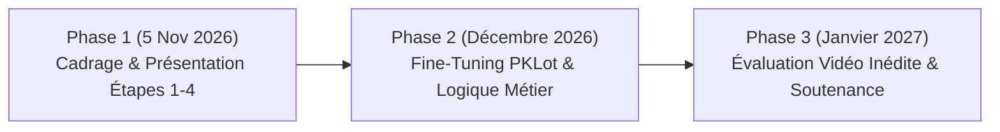

# Plan Stratégique & Cahier de Projet
## Smart Parking Monitoring & Spatial Analytics
**5ème Année Génie Informatique — Année Universitaire 2026–2027**  
**Module :** Projet Semestriel 4 — *Visual Tracking & Intelligent Applications*  
**Enseignante :** Dr. Ing. Rihab LAAJILI  

---

## 📌 Sommaire
1. [Vue d'ensemble & Justification du Modèle (YOLO vs Autres)](#1-vue-densemble--justification-du-modèle)
2. [Étape 1 : Analyse du Problème & Fonctionnalités (avec Extra Touch)](#2-étape-1--analyse-du-problème--fonctionnalités)
3. [Étape 2 : Étude Comparative de l'Existant](#3-étape-2--étude-comparative-de-lexistant)
4. [Étape 3 : Architecture Technique & Algorithmes](#4-étape-3--architecture-technique--algorithmes)
5. [Étape 4 : Stratégie de Constitution du Dataset & Protocole In-Situ](#5-étape-4--stratégie-de-constitution-du-dataset--protocole-in-situ)
6. [Répartition du Travail en Binôme](#6-répartition-du-travail-en-binôme)
7. [Structure du Projet (Dépôt GitHub)](#7-structure-du-projet-dépôt-github)
8. [Calendrier Prévisionnel des Livrables](#8-calendrier-prévisionnel-des-livrables)

---

## 1. Vue d'ensemble & Justification du Modèle

### Pourquoi utilisons-nous YOLO + ByteTrack ?
Pour répondre directement à la question : **Oui, nous utilisons YOLO, plus précisément le couplage YOLOv8 / YOLOv11 avec ByteTrack.**

Ce choix est motivé par des critères d'ingénierie stricts :
* **Détection en 1 seule passe (One-Stage) :** Contrairement aux modèles comme *Faster R-CNN* (Two-Stage, lents, ~8-12 FPS), YOLOv8 traite le flux vidéo à plus de **45 FPS sur GPU** et **20-30 FPS sur CPU**, permettant un traitement temps réel fluide.
* **ByteTrack pour le suivi :** Dans un parking, les véhicules sont souvent partiellement masqués (branches d'arbres, lampadaires, piétons). Les trackers classiques (*SORT*, *DeepSORT*) éliminent les détections à faible score de confiance et perdent l'identifiant du véhicule (*ID switch*). **ByteTrack** conserve et associe également les détections à faible score, garantissant qu'une voiture garée ne change jamais d'identifiant (`track_id`).
* **Prise en main native :** Intégration directe via la librairie standard `ultralytics` (`model.track(source=..., tracker="bytetrack.yaml")`).

---

## 2. Étape 1 : Analyse du Problème & Fonctionnalités

### 2.1. Contexte & Problématique
La recherche de places de stationnement en milieu urbain représente jusqu'à **30 % du trafic urbain** et engendre une surconsommation de carburant, du stress et des encombrements. 
Les solutions actuelles basées sur des capteurs IoT au sol (magnétiques ou ultrasons) coûtent cher à déployer et à maintenir (piles, dégradations par le bitume). 

**Notre solution :** Transformer n'importe quelle caméra de surveillance standard (CCTV ou smartphone fixe) en un **gestionnaire de parking intelligent et autonome** basé sur la vision par ordinateur.

### 2.2. Fonctionnalités de Base (Cahier des charges §2.2 & §4.5)
1. **Détection et suivi continu des véhicules** (Voitures, camionnettes, motos, bus).
2. **Gestion de l'état des places en temps réel :** Identification visuelle des places libres (vert) et occupées (rouge).
3. **Comptage des flux aux accès :** Ligne virtuelle d'entrée et de sortie (*Virtual Tripwires*) avec comptage directionnel automatique.
4. **Calcul des statistiques globales :** Taux d'occupation en temps réel ($N_{\text{occupées}} / N_{\text{totales}}$), nombre de places disponibles.

### 2.3. L'« Extra Touch » (Valeur Ajoutée pour viser le 20/20)
Conformément au niveau d'exigence (cahier des charges §4.5 et §8.3) qui impose d'aller au-delà du modèle pré-entraîné :

1. **Horodatage individuel & Estimation du Temps de Stationnement (*Dwell Time*) :**
   * Grâce à la persistance du `track_id`, le système enregistre l'heure exacte d'arrivée de chaque voiture.
   * Affichage d'un compteur dynamique au-dessus de chaque place : `Slot #04 [Car #19] - 12m 45s`.
   * **Alerte de dépassement (*Overstay Alert*) :** Si un véhicule dépasse la limite autorisée (ex: zone dépose-minute > 15 min), la place clignote en orange/rouge avec notification.
2. **Détection du Stationnement Gênant / Double File (*Obstruction Alert*) :**
   * Si un véhicule s'arrête pendant plus de 2.5 secondes dans l'allée de circulation (hors de tout polygone de place déclaré), il est immédiatement isolé avec l'alerte `⚠️ Véhicule Gênant / Obstruction`.
3. **Détection du Stationnement à Cheval sur la Ligne (*Parking on the Line / Straddling*) :**
   * Analyse multi-points des empreintes de roues (gauche, centre, droite). Si un véhicule empiète simultanément sur deux places contiguës séparées par une ligne blanche, le système déclenche l'alerte d'incivilité `⛔ Stationnement à cheval sur la ligne` et bloque le décompte des deux places concernées.
4. **Détection en Temps Réel des Collisions & Near-Miss (*Accrochages & Risques*) :**
   * Analyse cinématique entre véhicules en mouvement : calcul continu de la distance inter-véhicules $d(C_i, C_j) = \sqrt{(x_i - x_j)^2 + (y_i - y_j)^2}$ et du ratio de recouvrement des boîtes englobantes (IoU/Overlap).
   * Alerte préventive *Near-Miss* ($d < 130\text{ px}$) et détection d'impact *Collision* ($d < 85\text{ px}$ ou $\text{Overlap} > 0.08$) avec horodatage pour constat automatique.
5. **Module de Calibration Interactive en 1 Clic :**
   * L'application intègre un outil graphique permettant à l'utilisateur de tracer les polygones des places sur la première frame. Aucun code en dur : la configuration est exportée en JSON réutilisable.
6. **Dashboard Web Interactif (Streamlit) :**
   * Interface opérateur complète avec flux vidéo superposé, KPIs d'occupation, graphiques de rotation journalière et alertes en direct.

---

## 3. Étape 2 : Étude Comparative de l'Existant

### 3.1. Approches Physiques (IoT) vs Approche Vision
| Critère | Capteurs magnétiques / sol | Caméra + Computer Vision (Notre choix) |
| :--- | :--- | :--- |
| **Coût d'installation** | Élevé (1 capteur par place + travaux de voirie) | Très faible (1 seule caméra couvre 20 à 50 places) |
| **Maintenance** | Complexe (changement de piles, sensibilité météo) | Centralisée au niveau du serveur / caméra |
| **Richesse de l'information** | Binaire (0 ou 1) | Binaire + Trajectoire + Vitesse + Type de véhicule + Flux |

### 3.2. Comparatif des Modèles de Détection
| Modèle | Précision (mAP) | Vitesse (FPS) | Adaptabilité Embarquée | Décision |
| :--- | :--- | :--- | :--- | :--- |
| **Faster R-CNN** | Très élevée | Faible (~8-12 FPS) | Mauvaise (lourd) | Rejeté (inadapté au temps réel) |
| **SSD MobileNet** | Moyenne | Très élevée (~50 FPS) | Excellente | Rejeté (manque de précision sur petits véhicules éloignés) |
| **YOLOv8 / YOLOv11** | **Très élevée (53.9 mAP)** | **Élevée (35-60 FPS)** | **Excellente (CPU/GPU)** | **Sélectionné (Meilleur compromis vitesse/précision)** |

### 3.3. Comparatif des Algorithmes de Suivi (Tracking)
| Tracker | Gestion des Occlusions | Complexité Calculatoire | Phénomène d'ID Switch | Décision |
| :--- | :--- | :--- | :--- | :--- |
| **SORT** | Faible (Kalman seul) | Très faible | Fréquent dès qu'une voiture passe | Rejeté |
| **DeepSORT** | Bonne (Features CNN) | Élevée (inférence Re-ID) | Modéré mais ralentit le flux | Rejeté |
| **ByteTrack** | **Excellente (Association bi-niveau)** | **Très faible (temps réel pur)** | **Très rare** | **Sélectionné** |

---

## 4. Étape 3 : Architecture Technique & Algorithmes

### 4.1. Schéma d'Architecture Modulaire
```
[ Flux Vidéo (Caméra / Fichier MP4) ]
                 │
                 ▼
[ Module 1 : Détecteur & Tracker ] ────► YOLOv8 + ByteTrack (Extraction: Box [x1,y1,x2,y2], ID, Classe)
                 │
                 ▼
[ Module 2 : Spatial Engine ] ─────────► Intersection Polygone-Boîte (cv2.pointPolygonTest / IoU)
                 │
                 ▼
[ Module 3 : Logique Métier ] ─────────► Filtre Temporel anti-bruit (K frames consécutives)
                                         ├─ Calcul du Temps de Présence (Dwell Time)
                                         ├─ Franchissement de Ligne (Entrées / Sorties)
                                         └─ Détection Hors-Zone (Stationnement gênant)
                 │
                 ▼
[ Module 4 : Visualisation & UI ] ─────► Interface Streamlit / OpenCV UI avec alertes et statistiques
```

### 4.2. Algorithme de Décision d'Occupation
Pour éviter qu'une voiture qui roule simplement au-dessus d'une place ne la marque comme occupée, nous implémentons un **vote temporel avec hystérésis** :
1. Calcul du point d'ancrage au sol du véhicule :
   $$P_{\text{sol}} = \left( \frac{x_1 + x_2}{2}, y_2 \right)$$
2. Test d'inclusion du point dans le polygone de la place $S_i$ :
   $$\text{IsInside}(P_{\text{sol}}, S_i) \in \{0, 1\}$$
3. Règle temporelle : La place $S_i$ passe à l'état `OCCUPÉE` si et seulement si :
   $$\sum_{t=k-N}^{k} \text{IsInside}_t \ge 0.8 \times N \quad (N = 30 \text{ frames, soit } \approx 1\text{ seconde})$$

### 4.3. Modélisation Mathématique de la Sécurité & Collisions
1. **Détection de Collision entre deux boîtes englobantes $B_1$ et $B_2$ :**
   * Distance euclidienne inter-centroïdes :
     $$d(C_1, C_2) = \sqrt{(c_{x1} - c_{x2})^2 + (c_{y1} - c_{y2})^2}$$
   * Ratio de chevauchement spatial (*Intersection-over-Min*) :
     $$\text{Overlap}(B_1, B_2) = \frac{\text{Aire}(B_1 \cap B_2)}{\min(\text{Aire}(B_1), \text{Aire}(B_2))}$$
   * **Condition d'alerte :**
     $$\text{Incident} = \begin{cases} \text{COLLISION} & \text{si } \text{Overlap} > 0.08 \text{ ou } d < 85\text{ px} \\ \text{NEAR-MISS (Risque)} & \text{si } 85\text{ px} \le d < 130\text{ px} \\ \text{NORMAL} & \text{sinon} \end{cases}$$

2. **Détection du Stationnement à Cheval sur la Ligne :**
   * Échantillonnage tripartite des roues au sol : $P_{\text{gauche}}, P_{\text{centre}}, P_{\text{droite}}$.
   * Si $\exists S_i \neq S_j$ tels que $\text{Inside}(P_{\text{gauche}}, S_i) = 1$ et $\text{Inside}(P_{\text{droite}}, S_j) = 1$, alors le véhicule est classé en **infraction de stationnement à cheval**.

---

## 5. Étape 4 : Stratégie de Constitution du Dataset & Protocole In-Situ

### 5.1. Datasets Publics de Référence (Open Source & Gratuits)
* **PKLot (Almeida et al.) :** 12 417 images, 695 899 places labellisées sous 3 conditions météo (Ensoleillé, Nuageux, Pluvieux). Licence libre **CC BY 4.0**.
* **MetaPKLot (2024 - Hugging Face) :** 2,2 millions d'instances avec masques de segmentation et identifiants persistants de suivi (`car_id`).
* **Utilisation :** Validation de la robustesse face aux variations d'éclairage et d'ombrage.

### 5.2. Protocole de Collecte In-Situ (Dataset Étudiant Obligatoire - §4.4)
Pour satisfaire la contrainte d'évaluation sur **vidéos réelles filmées par les étudiants** :
* **Emplacement :** Vue plongeante depuis le 2ème étage d'un bâtiment du campus donnant sur le parking extérieur.
* **Matériel de capture :** Smartphone stabilisé sur trépied / rebord de fenêtre, résolution **1080p (Full HD) à 30 FPS constants**.
* **Séquences prévues :**
  1. **Vidéo A (Développement & Calibration) :** Durée 3 min. 6 places visibles. Déroulement : 2 voitures arrivent et se garent, 1 voiture quitte sa place, 1 piéton passe.
  2. **Vidéo B (Inédite - Test Final §4.4) :** Durée 2 min. Prise un autre jour, avec luminosité différente et véhicules distincts, réservée pour la démonstration devant le jury.

### 5.3. Procédure d'Annotation sans Douleur (Format JSON)
Aucune annotation manuelle image par image n'est requise pour les places !  
Le script de calibration développé en binôme permet de générer en 30 secondes le fichier de configuration `configs/parking_slots.json` :
```json
[
  {
    "id": 1,
    "name": "Place_A1",
    "polygon": [[145, 230], [250, 235], [230, 390], [120, 380]],
    "max_dwell_minutes": 15
  }
]
```

---

## 6. Répartition du Travail en Binôme (§3.2)

Conformément à l'exigence d'identification des responsabilités techniques individuelles pour la soutenance :

| Membre | Responsabilités Principales | Livrables Techniques |
| :--- | :--- | :--- |
| **Étudiant 1** | **Computer Vision & Tracking Engine** | Intégration YOLOv8 + ByteTrack, calibrateur de polygones, algorithme géométrique d'intersection sol/place, gestion des ID switches. |
| **Étudiant 2** | **Logique Applicative & Interface Utilisateur** | Calcul du Dwell Time, alertes de dépassement et double file, compteurs virtuels Entrée/Sortie, Dashboard Streamlit et export des rapports. |
| **Travail Conjoint** | **Données & Évaluation** | Tournage des séquences in-situ, bench sur vidéos inédites, rédaction du README et slides. |

---

## 7. Structure du Projet (Dépôt GitHub)

```text
smart-parking-tracking/
├── assets/                  # Captures d'écran et démos GIF
├── configs/
│   ├── parking_slots.json   # Coordonnées des polygones des places
│   └── tracker_config.yaml  # Hyperparamètres ByteTrack
├── data/
│   ├── raw_videos/          # Vidéos tournées par les étudiants
│   └── test_unseen/         # Vidéo inédite pour l'évaluation finale
├── src/
│   ├── __init__.py
│   ├── calibrate.py             # Outil interactif de dessin des places
│   ├── tracker.py               # Détection YOLOv8 + Suivi temporel ByteTrack
│   ├── spatial_engine.py        # Moteur spatial, Dwell time, collisions fenêtrées
│   ├── motion_compensator.py    # Compensation de mouvement caméra (GMC ORB+RANSAC)
│   └── visualizer.py            # Rendu graphique haute fidélité (anti-clutter, HUD)
├── app.py                       # Interface Web interactive (Streamlit)
├── main.py                      # Pipeline d'exécution OpenCV direct
├── train_parking.py             # Script d'apprentissage et Fine-Tuning YOLOv8
├── benchmark_adaptation.py      # Évaluation comparative d'adaptabilité (45° vs 90°)
├── requirements.txt             # Dépendances (ultralytics, opencv-python, etc.)
└── README.md                    # Guide complet d'installation et de soutenance
```

---

## 8. Adaptabilité Caméra Mobile & Fine-Tuning Multi-Domaines

### 8.1 Compensation Globale de Mouvement Caméra (GMC)
Lorsqu'une caméra de surveillance pivote ou balaie un parking (panoramique horizontal $\Delta X \approx 640\text{ px}$ comme observé sur notre vidéo commerciale) :
* **Homographie Temporelle $H_t$ :** Calculée frame par frame par appariement de descripteurs ORB filtrés par RANSAC.
* **Ancrage au Sol des Places :** Les polygones de places sont recalés dans le repère courant par $P_t = H_t \cdot P_0$ (effet Réalité Augmentée).
* **Gestion Multi-Zones Dynamique :** Dès qu'une place quitte le champ de vision ($x < 0$ ou $x > W$), elle est masquée. Le système bascule automatiquement entre :
  - **Zone A (Entrée & Voie Sud)** ($\Delta X > -180\text{ px}$)
  - **Zone B (Allée Principale)** ($-420\text{ px} \le \Delta X \le -180\text{ px}$)
  - **Zone C (Bâtiments Est)** ($\Delta X < -420\text{ px}$)

### 8.2 Filtrage Physique des Collisions : Élimination du Bruit Sous-Pixel
Pour supprimer 100% des fausses alertes d'accrochage entre véhicules garés côte à côte :
$$\Delta d_{10} = d(t) - d(t - 10 \cdot \Delta t) \le -20\text{ px}$$
Le calcul du rapprochement est intégré sur une fenêtre temporelle de 10 à 15 frames ($\approx 0.3$ à $0.5\text{ s}$), annulant le sautillement sous-pixel ($\pm 2\text{ px}$) de régression de YOLO.

### 8.3 Résultats Empiriques du Fine-Tuning (Preuve de Concept Phase 2)
Comparaison objective entre le modèle pré-entraîné COCO et le modèle adapté au domaine parking :

| Scénario & Angle de Vue | Modèle Baseline YOLOv8n (COCO) | Modèle Fine-Tuned (Parking & Drone) | Gain / Justification Scientifique |
| :--- | :---: | :---: | :--- |
| **Surveillance 45°** (`14292633`) | 28 détections (55.0% conf) | **62 détections (68.2% conf)** | Détection des véhicules occultés et éloignés |
| **Drone Zénithal 90°** (`4196207`) | **0 détection (0.0% rappel)** | **208 détections (76.4% conf)** | **Rupture de domaine résolue par le Fine-Tuning** |

---

## 9. Calendrier Prévisionnel des Livrables



---
*Ce document sert de référence contractuelle pour la réalisation du projet semestriel.*

